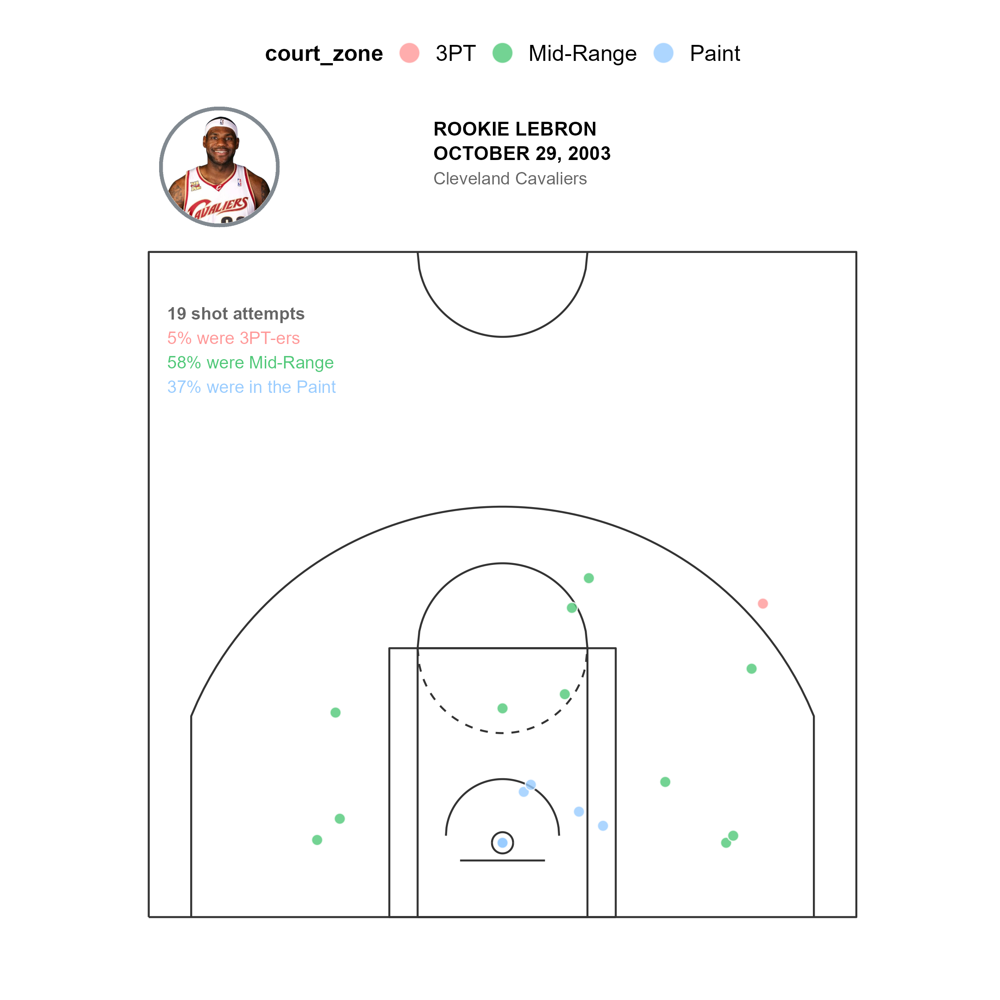
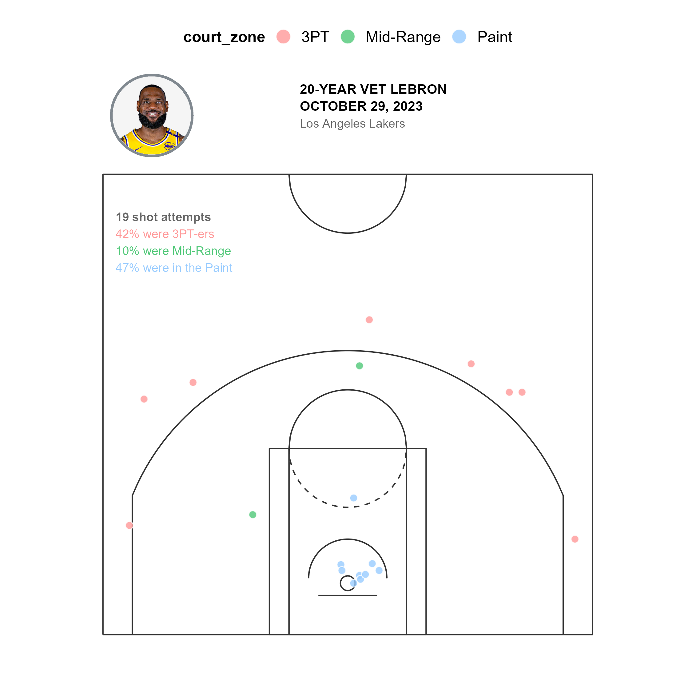
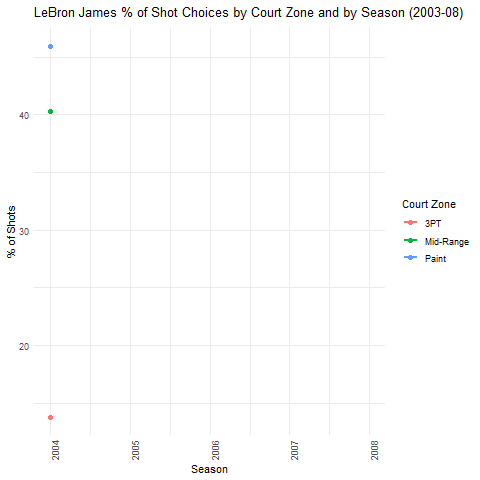
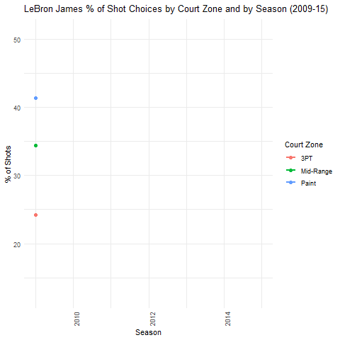
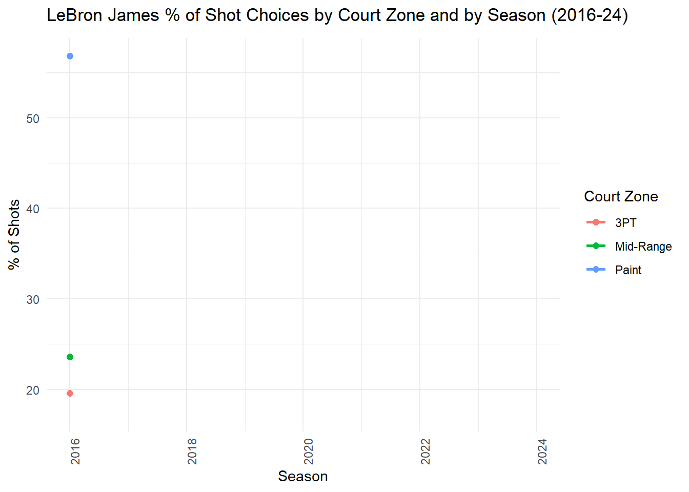
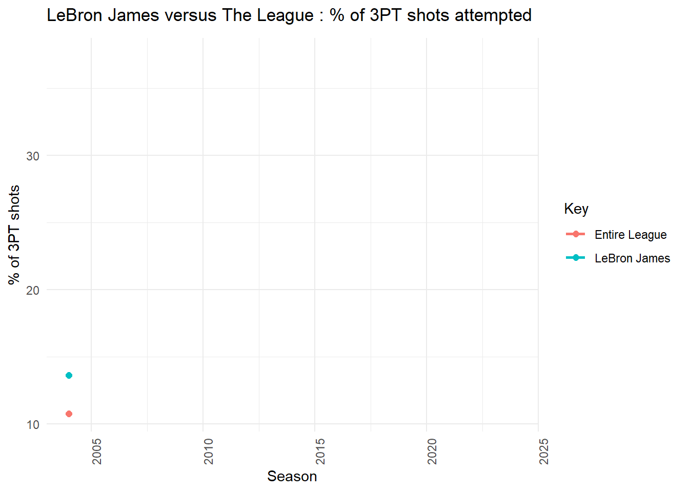

```{r setup, warning=FALSE, message=FALSE}
# Load shared functions and libraries
source("../_common.R")

# Read csv file with all NBA shots data from 2003 to 2024
all_shots <- read.csv("../data/allshots-2003-2024.csv")
```

> *"It is our choices that show what we truly are, far more than our abilities."* – J.K. Rowling

## A rookie's first game

On October 29, 2003, 18-year-old LeBron James made his first shot decision as an NBA player. It wasn't a flashy dunk or a deep three. It was a mid-range jumper - plain, efficient, unremarkable. Two points.

::: column-margin
[LeBron's 1st NBA Game: October 29, 2003](https://youtu.be/JLjH0rrNFeU?si=R5YavOwTrWUNfcZ2){target="_blank"}
:::

But that single shot spoke volumes. It told us what basketball was in 2003: a game that valued size and strength, rewarded mid-range specialists, and treated the three-point (3PT) line as an occasional luxury.

Fast forward 20 years, and that same decision would look out of place. Today's NBA is unrecognizable. 3PT-ers aren't just common - they're necessary. Mid-range shots are now basketball's version of a landline phone: technically still around, but rarely used.

::: column-margin
[LeBron, 20 years later: October 29, 2023](https://youtu.be/7-q0NDE-_bw?si=mcOFaFomUdgVMu6w){target="_blank"}
:::

::: {.panel-tabset .nav-pills}
## 1st NBA game



## 20 years later



## Comparing 2003 vs 2023

```{r slope-chart, warning=FALSE, message=FALSE}
# Generate LeBron's slope chart comparing 2003 vs 2023
base_lebron_slope_chart <- shots_game_by_game_slope_chart(all_shots, "LeBron James", 20031029, 20231029)

# Style the chart
base_lebron_slope_chart +
  scale_x_discrete(labels = c("20031029" = "October 29, 2003", "20231029" = "October 29, 2023")) +
  labs(
    title = "LeBron's shot choices: Oct. 29, 2003 vs. 2023",
    subtitle = "His 3PT attempts went up from 5% to 42% of all shot choices",
    x = "",
    y = "% of shots") +
  theme_bounce_back() +
  theme(
    legend.position = "none",
    plot.title = element_text(size = 14, face = "bold"),
    plot.subtitle = element_text(size = 10)
  )
```
:::

This is the story of how LeBron's shot selection changed over two decades, and how those choices reflect the shifting forces that reshaped the game of basketball.

## 2003-2008: The power of playing to your strengths

In LeBron's early years, the game was simple: get to the basket.

He was faster, stronger, and more athletic than most players on the court. Why take a risky 3PT-er when you could bulldoze your way to the rim? Over 40% of his shots came from the paint, where he was nearly unstoppable.

The mid-range jumper (like the one he made in his first game) was his secondary weapon. And it worked because it fit the league's style. Coaches weren't chasing efficiency metrics yet. The paint and mid-range were where championships were won.

LeBron wasn't just playing basketball. He was thriving in a system built for players like him. The lesson? **Success often comes from maximizing what works in the moment, even if it won't last forever.**



## 2009-2015: Learning to adapt

By 2009, the NBA was changing. The 3PT revolution, sparked by analytics and players like Stephen Curry, was underway. LeBron noticed.

He didn't immediately abandon the mid-range game - it was still part of his identity - but he started taking more 3PT-ers. Slowly, deliberately, he added them to his repertoire. By the time he joined the Miami Heat in 2010, and with the influence of teammates like Ray Allen who joined the Heat in 2012, his 3PT attempts had grown to 25% of his total shots.

LeBron's willingness to adapt showed a crucial insight: **the best performers don't just play their game - they adjust to the rules as they change.**



## 2016-2024: Embracing the new reality

The modern NBA belongs to the 3PT-er, and so does LeBron.

Between 2016 and 2024, over 35% of his shots came from beyond the arc. The mid-range? Almost gone. The paint? Still important, but less dominant than before.

This wasn't a concession—it was a strategy. LeBron didn't stop attacking the basket. He just became more selective, choosing to drive when it mattered most and saving his energy for long-range daggers.

The league had fully transitioned to an era of spacing and efficiency ("Sprawl" Ball as it's called). Teams weren't just tolerating 3PT-ers — they were building offenses around them. LeBron's game evolved accordingly.

The takeaway here is simple: **the ability to change isn't a weakness. It's a competitive advantage.**



## LeBron as a mirror to the NBA

LeBron's career isn't just about scoring points. It's about reflecting the game's evolution.

Consider this: In 2004, around 10% of all shot attempts made in the NBA, per season, were 3PT-ers. By 2024, that percentage had skyrocketed to over 30%. LeBron adapted not because he wanted to - but because he had to.

```{r lebron-vs-league, warning=FALSE, message=FALSE, eval=FALSE}
# This code generates the LeBron vs League comparison
# Pre-computed animation is used for faster rendering

# Filter league shots and LeBron shots
league_shots <- all_shots |>
  mutate(x = (locationX / 10) - 0,
         y = (locationY / 10) - 41.75) |>
  filter(y < 0) |>
  mutate(
    court_zone = case_when(
      distanceShot <= 8 ~ "Paint",
      distanceShot > 8 & distanceShot < 23 ~ "Mid-Range",
      distanceShot >= 23 ~ "3PT",
      TRUE ~ "Other"
    )
  )

lebron_shots <- league_shots %>%
  filter(namePlayer == "LeBron James")

# Calculate percentages and create visualization...
```

{fig-align="center"}

The NBA's greatest players aren't just defined by their talent. They're defined by how well they adjust when the rules of the game change.

## What his journey can teach us

LeBron's evolution is a lesson in adaptability. He started his career mastering the tools of his era. Then, as the game changed, he didn't resist - he evolved with it.

For players entering the league today, the message is clear: **success isn't just about being great at one thing. It's about being willing to reinvent yourself when the world around you changes.**

LeBron's journey isn't just about basketball. It's about the universal truth that staying relevant requires constant evolution. The game always changes. The question is whether you'll change with it.

**The King's reign is a testament to one simple idea: if you want to last, you have to evolve.**

---

## Key Takeaways

::: {.callout-tip}
## Lessons from LeBron's Adaptability

1. **Play to your strengths** - Early in his career, LeBron dominated the paint because that's where he was unstoppable
2. **Watch for signals of change** - He noticed the 3PT revolution before it fully arrived and started preparing
3. **Evolve deliberately** - His transition wasn't overnight; it was gradual and strategic
4. **Don't abandon what works** - He still attacks the paint when it matters most
5. **Embrace the new reality** - When the game changed, he changed with it
:::

---

## References

- Rowling, J.K. (1998). *Harry Potter and the Chamber of Secrets*. London: Bloomsbury Publishing.
- [LeBron's first NBA game (October 29, 2003)](https://www.youtube.com/watch?v=JLjH0rrNFeU)
- [LeBron's game 20 years later (October 29, 2023)](https://youtu.be/7-q0NDE-_bw)
- Abresler, A. [nbastatR: A comprehensive R package for NBA statistics](https://github.com/abresler/nbastatR)
