::: {.hero-banner}
{.hero-image fig-align="center" width="150px"}

### What can we learn from basketball's greatest legends?

This project explores the careers of 12 NBA icons through data visualization and storytelling. Each chapter examines how these players made decisions, led their teams, and mastered their craft—offering lessons that extend far beyond the court.

[Start Reading](chapters/intro.qmd){.btn .btn-primary .btn-lg}
:::

---

## The 12 Disciples of Basketball Wisdom

::: {.grid}

::: {.g-col-12 .g-col-md-6 .g-col-lg-3}
### Decision-Making {.section-header}

How the greats made choices under pressure.

::: {.card .chapter-card}
[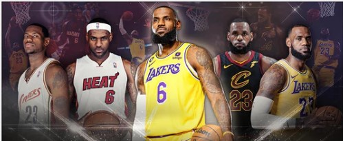{.card-img-top}](chapters/lebron.qmd)

::: {.card-body}
#### [LeBron James](chapters/lebron.qmd)
**The King of Adaptability**

How the evolution of LeBron's shot choices mirrors the NBA's transformation (2003-2024).
:::
:::

::: {.card .chapter-card}
[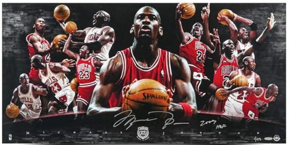{.card-img-top}](chapters/jordan.qmd)

::: {.card-body}
#### [Michael Jordan](chapters/jordan.qmd)
**The Last Shot**

Exploring Jordan's ability to deliver in high-pressure moments and his relentless competitive spirit.
:::
:::

::: {.card .chapter-card}
[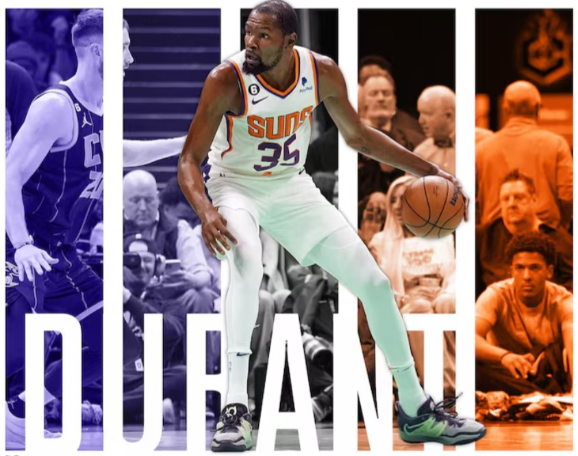{.card-img-top}](chapters/durant.qmd)

::: {.card-body}
#### [Kevin Durant](chapters/durant.qmd)
**The Shape-Shifter**

Examining Durant's career through the lens of adaptability, personal growth, and resilience.
:::
:::

::: {.card .chapter-card}
[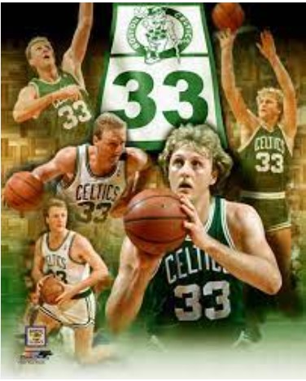{.card-img-top}](chapters/bird.qmd)

::: {.card-body}
#### [Larry Bird](chapters/bird.qmd)
**The Fast Mind**

Delving into Bird's basketball IQ and strategic thinking that made him a legend.
:::
:::

:::

::: {.g-col-12 .g-col-md-6 .g-col-lg-3}
### Leadership {.section-header}

How the greats elevated those around them.

::: {.card .chapter-card}
[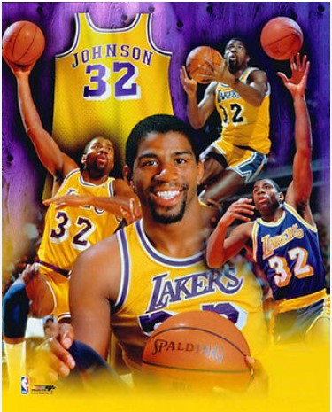{.card-img-top}](chapters/magic.qmd)

::: {.card-body}
#### [Magic Johnson](chapters/magic.qmd)
**The Invisible Hand**

Magic's unique leadership style and how he elevated the performance of his teammates.
:::
:::

::: {.card .chapter-card}
[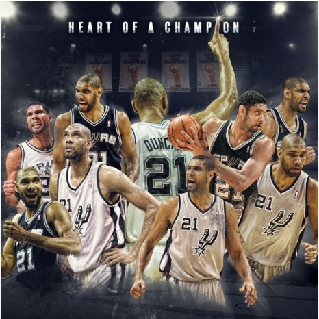{.card-img-top}](chapters/duncan.qmd)

::: {.card-body}
#### [Tim Duncan](chapters/duncan.qmd)
**Foundation of Greatness**

Duncan's understated but highly effective leadership style and consistency.
:::
:::

::: {.card .chapter-card}
[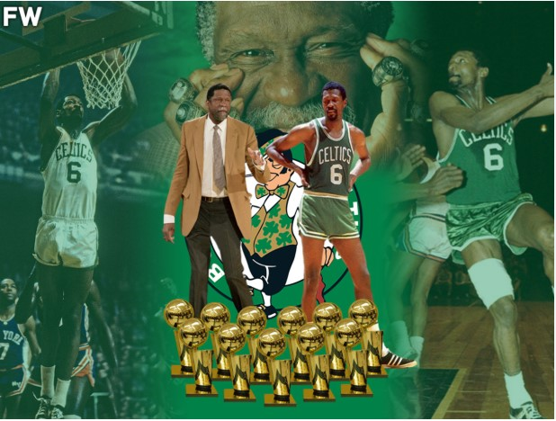{.card-img-top}](chapters/russell.qmd)

::: {.card-body}
#### [Bill Russell](chapters/russell.qmd)
**The Invisible Scoreboard**

Russell's legacy as a defensive anchor who prioritized collective success over individual accolades.
:::
:::

::: {.card .chapter-card}
[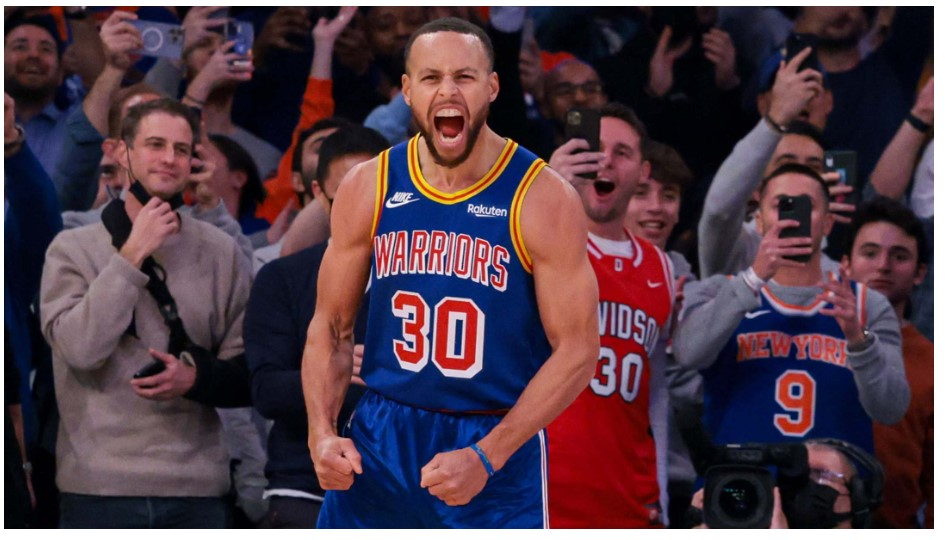{.card-img-top}](chapters/curry.qmd)

::: {.card-body}
#### [Stephen Curry](chapters/curry.qmd)
**Gravity of Greatness**

How Curry's revolutionary shooting and off-ball movement redefined team strategies.
:::
:::

:::

::: {.g-col-12 .g-col-md-6 .g-col-lg-3}
### Mastery {.section-header}

How the greats perfected their craft.

::: {.card .chapter-card}
[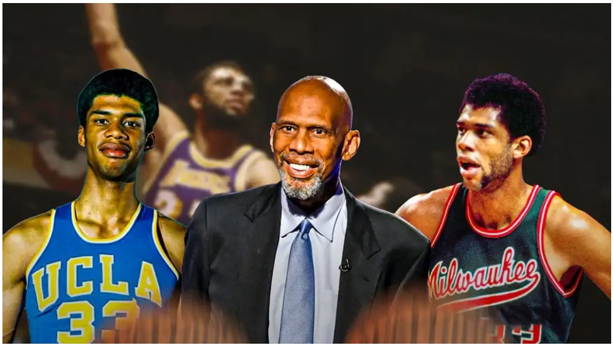{.card-img-top}](chapters/kareem.qmd)

::: {.card-body}
#### [Kareem Abdul-Jabbar](chapters/kareem.qmd)
**The Infinite Game**

How Kareem's Skyhook redefined basketball and his ability to sustain excellence across decades.
:::
:::

::: {.card .chapter-card}
[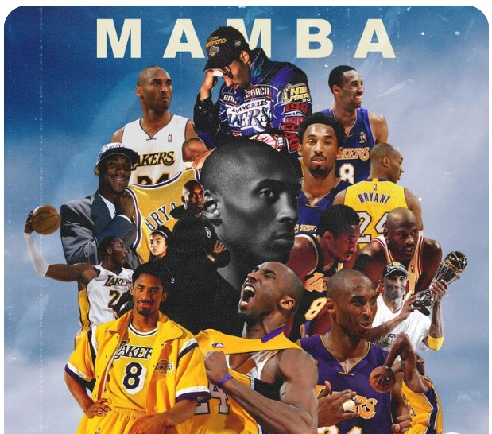{.card-img-top}](chapters/kobe.qmd)

::: {.card-body}
#### [Kobe Bryant](chapters/kobe.qmd)
**Mamba Mentality**

Kobe's obsessive work ethic and how relentless preparation shaped his career.
:::
:::

::: {.card .chapter-card}
[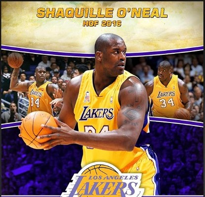{.card-img-top}](chapters/shaq.qmd)

::: {.card-body}
#### [Shaquille O'Neal](chapters/shaq.qmd)
**The Sledgehammer Effect**

Shaq's physical dominance and how embracing unique strengths leads to extraordinary impact.
:::
:::

::: {.card .chapter-card}
[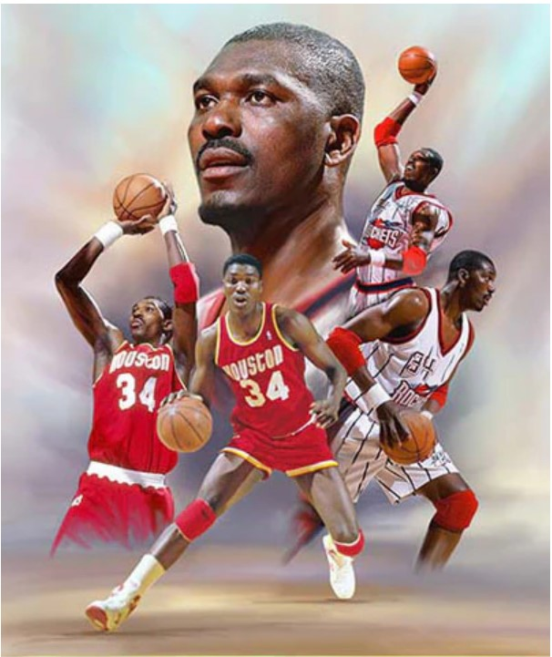{.card-img-top}](chapters/hakeem.qmd)

::: {.card-body}
#### [Hakeem Olajuwon](chapters/hakeem.qmd)
**The Dream's Blueprint**

Hakeem's precision, patience, and mastery of fundamentals, particularly his footwork.
:::
:::

:::

:::

---

## Appendices

::: {.grid}

::: {.g-col-12 .g-col-md-4}
::: {.card .appendix-card}
[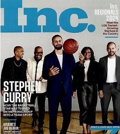{.card-img-top}](appendices/entrepreneurship.qmd)

::: {.card-body}
#### [Appendix A: The Entrepreneurial 3-Pointer](appendices/entrepreneurship.qmd)

How entrepreneurship is similar to shooting from the 3PT line—high risk, high reward, and the courage to take the shot.
:::
:::
:::

::: {.g-col-12 .g-col-md-4}
::: {.card .appendix-card}
[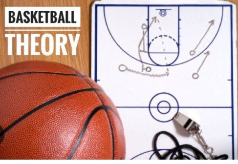{.card-img-top}](appendices/prospect-theory.qmd)

::: {.card-body}
#### [Appendix B: Psychology of Shot Choice](appendices/prospect-theory.qmd)

Examining shot choices through the lens of Prospect Theory and behavioral economics.
:::
:::
:::

::: {.g-col-12 .g-col-md-4}
::: {.card .appendix-card}
[{.card-img-top}](appendices/cookbook.qmd)

::: {.card-body}
#### [Appendix C: Highcharter Cookbook](appendices/cookbook.qmd)

A comprehensive guide to creating beautiful NBA charts using the Highcharter R package.
:::
:::
:::

:::

---

::: {.about-section}
## About This Project

**Bounce Back** is a data-driven exploration of what makes NBA legends great—and what we can learn from their journeys. Each chapter combines statistical analysis, interactive visualizations, and storytelling to reveal insights about decision-making, leadership, and mastery.

Whether you're a basketball fan, a data enthusiast, or someone seeking inspiration from greatness, there's something here for you.

**Author:** King Matayo
**Contact:** [kingmatayo.thefirst@gmail.com](mailto:kingmatayo.thefirst@gmail.com)
:::
